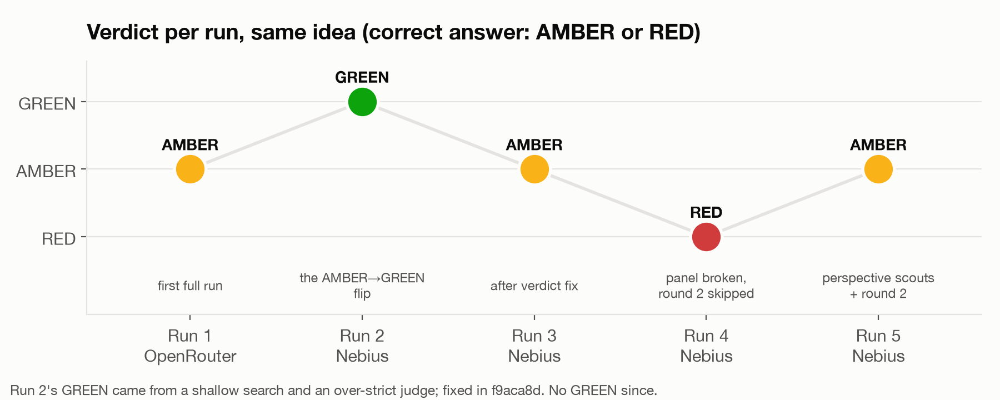
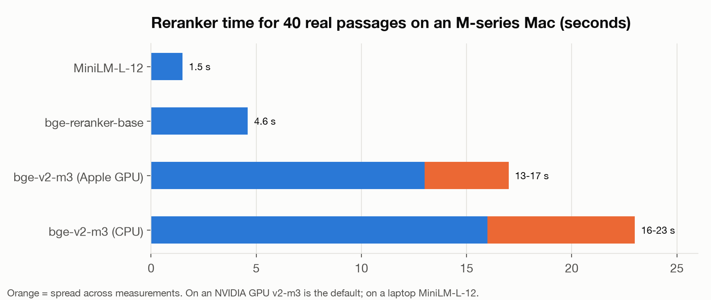
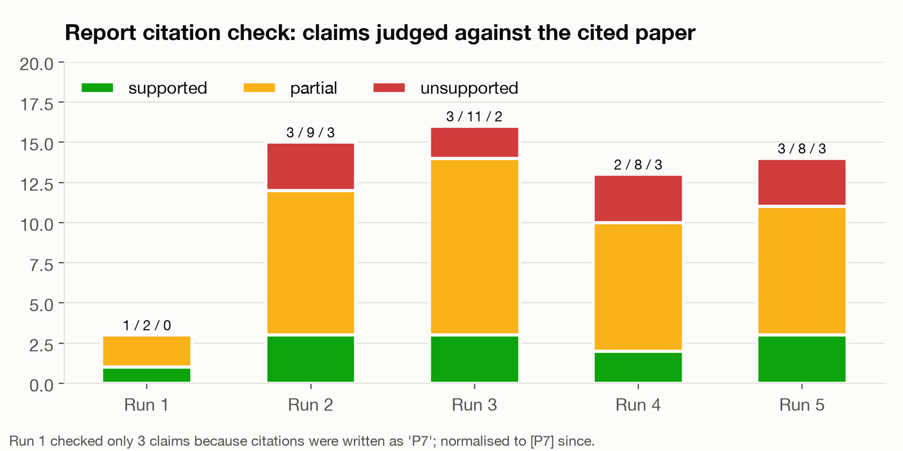
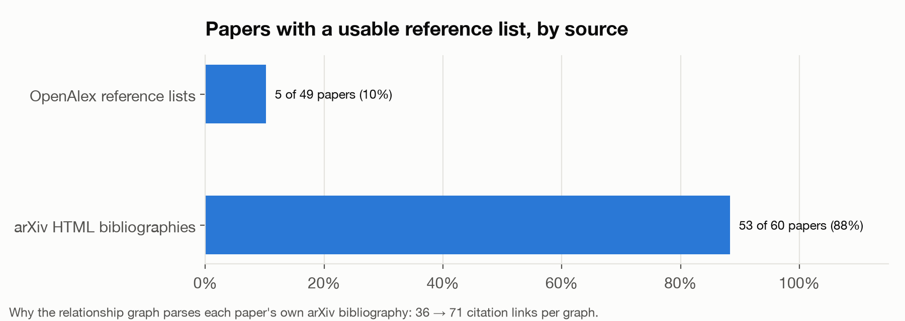
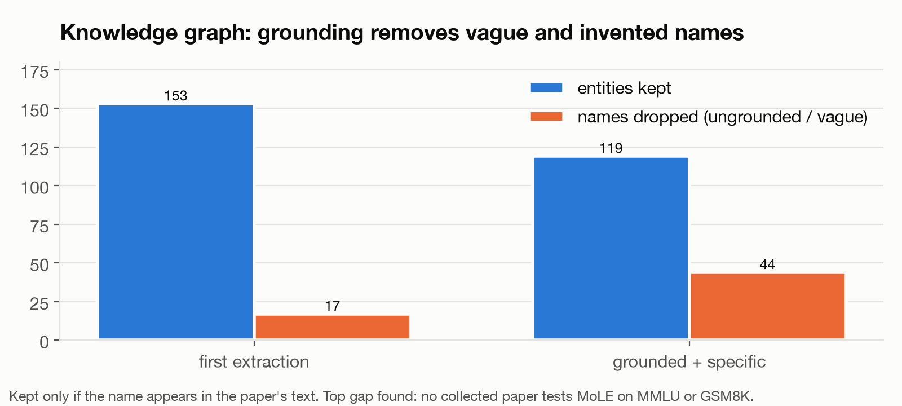
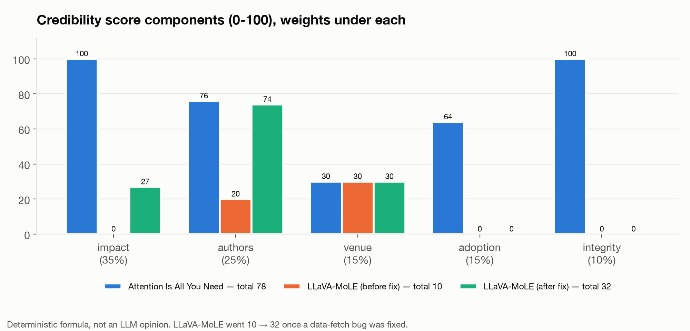
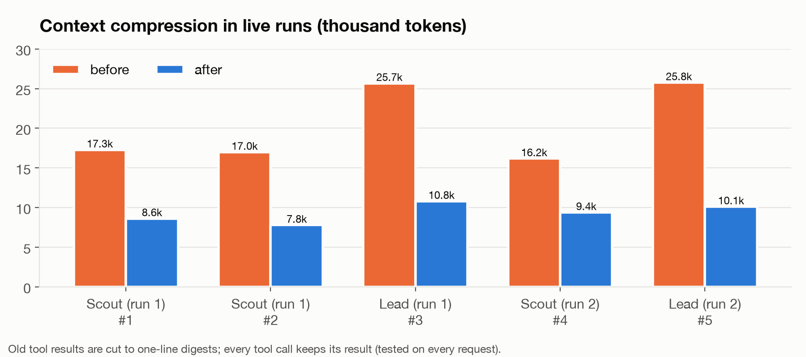
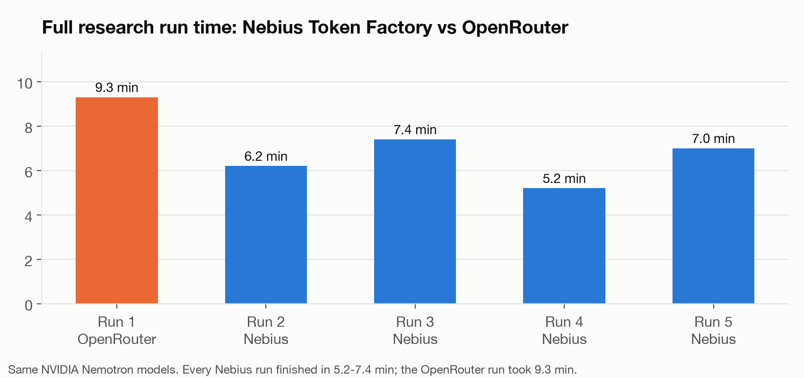
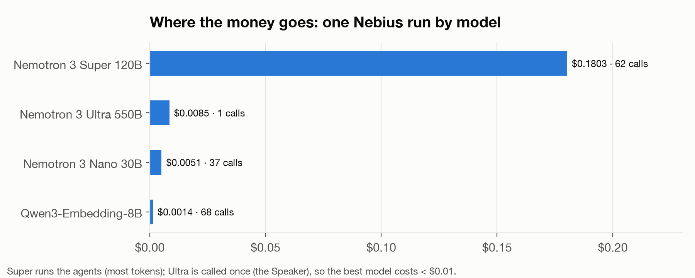

# GreenLight Research

**Has your research idea already been done?** Describe it in a chat. A team of AI agents searches the literature,
scores how credible every paper is, checks your idea against the closest work part by part, argues both sides, and
gives a verdict: **green** (novel, pursue it), **amber** (partly done, sharpen it) or **red** (already done). Every
claim links to the paper that supports it, and you can keep asking questions afterwards.

Built for the NVIDIA × Nebius hackathon (Apps & Agentic AI) on open models only.

> Every design choice in this README states the measurement that caused it. The numbers come from six live research
> runs on the same test idea (18 Oct 2026), a retrieval eval on a 180-paper corpus, and component benchmarks. Charts
> are in [`docs/benchmarks/`](docs/benchmarks/).

---

## Powered by

| | What it does in GreenLight Research | Measured |
|---|---|---|
| **NVIDIA Nemotron 3** (Nano 30B · Super 120B · Ultra 550B) | Every agent. Super runs the Lead Researcher, Scouts, debate and report; Nano does the high-volume checks (Critic, audits, citation checks, compression, memory, knowledge graph); Ultra is the 3-judge Speaker panel that rules the verdict | 0.7-0.9 s per structured answer on Nebius; Ultra cost < $0.01 per run |
| **Qwen3-Embedding-8B** (+ Qwen3-Reranker-8B on our GPU) | Dense retrieval over every paper, hypothetical-answer search (HyDE), the paper similarity graph and the chat's long-term memory; Qwen3-Reranker-8B is the first-choice reranker when our GPU serves it | 68 embedding calls for $0.001 in a full run |
| **NVIDIA NeMo Retriever** | Reranking NIM (`llama-3.2-nv-rerankqa`) in the reranker chain, hosted on the NVIDIA API catalog or self-hosted | plugs in with one key (`NVIDIA_API_KEY`) |
| **Tavily** | Live web search (a guaranteed web sweep every run + the scouts' `search_web` tool) and Tavily Extract, which reads the full text of the closest papers | 24 web results and 3 new 2026 papers the scholarly indexes missed in one sweep; 6-12 full texts per run |
| **Nebius** | Token Factory serves all Nemotron and Qwen models; our Nebius GPU (288 GB HBM3e) hosts the big reranker; deploy on a Nebius VM with Container Registry and Object Storage | full research run 5.2-7.4 min on Token Factory vs 9.3 min on OpenRouter, same models |

Plus arXiv, OpenAlex, Hugging Face Papers and Semantic Scholar for papers, citations and credibility data.

---

## How it works

```
 Intake chat ──▶ testable brief: research question, method, claimed contributions      (Nemotron Super)
      │          your text is redacted (emails, names, keys…) before any model call or search
      ▼
 Planner ──▶ 2-5 idea components + search angles, always incl. 2 perspective angles
      ▼
 Lead Researcher ──dispatch──▶ Scout ∥ Scout ∥ Scout ∥ Scout          (each its own agent loop and context)
      │   ▲  compressed reports only        arXiv · OpenAlex · HF Papers · Tavily · citation graph · full texts
      │   └── Critic: round 1 is never final → targeted round 2
      ▼
 Web Scout (Tavily) ──▶ live web sweep for recent work the indexes miss
      ▼
 Relevance ranking (cross-encoder) → full texts (Tavily Extract) → credibility score ∥ Auditor (red flags)
      ▼
 Novelty matrix: idea components × closest papers, every overlap backed by a quote found in the paper,
                 re-checked by a strict second judge
      ▼
 Debate: Proponent ∥ Skeptic → Speaker panel: 3 × Nemotron Ultra, majority vote
      ▼
 Guardrails in code (can only make the verdict more cautious) → green / amber / red
      ▼
 Report with comparison table → citation check → relationship graph → knowledge graph → research chat
```

---

## Why it is built this way

### 1. A verdict you can trust: four fixes from one failure

We ran the same idea six times. The idea (route each token to a mixture of LoRA experts with a learned, load-balanced
gate, evaluated on FLAN and MMLU) has real prior work (MoLoRA, MixLoRA, LLaVA-MoLE), so the correct verdict is amber
or red.



Run 2 said **green**. Comparing it with run 1 showed why, and each finding became a change:

| What we measured in run 2 | What we changed because of it |
|---|---|
| Only 50 papers overlapped with run 1 (97 vs 180); the Critic approved round 1, so MoLoRA, the closest paper, was never found | **A second research round is mandatory.** The Critic rejects round 1 until round 2 has run |
| A strict judge downgraded all 19 "already done" overlaps to "partly", so novelty jumped from 0 to 50 | **The strict judge is mechanism-aware:** it only downgrades *setting* components (data, benchmarks); a mechanism used in another field still counts as done |
| The Lead's own review said every core component was covered, yet nothing stopped the green | **New guardrail:** if the review finds every core component covered and very close papers exist, the verdict is at least amber |
| LLaVA-MoLE does the same routing in a vision-language model and was easy to miss | **Two perspective scouts in every first round**, enforced in code: "same mechanism, other field or modality" and "skeptical reviewer: is this incremental?" |


**Speaker panel.** One judge is a single point of failure, so three Nemotron Ultra Speakers vote. Our first panel
sampled two of them at temperature 0.6, and sampling made their structured output unreliable (1 of 3 votes usable in
two runs). **Because of that, all three run at temperature 0 and get their diversity from different judging lenses**
(overall, strict novelty, significance). On the latest debate all three votes were valid: 3/3 amber. A split panel can
never produce green.

Result: after these fixes no run has gone green on this idea (runs 3 and 5 amber; run 4 red, from the "already done"
guardrail while the panel was still broken).

### 2. Tavily web sweep in every run

The runs above made only 0-1 Tavily web searches each: the scouts preferred arXiv and OpenAlex. But scholarly indexes
lag behind the newest work. **Because of that, every run now ends research with a Web Scout**: Tavily searches the
plan's key queries over the last year, and any arXiv papers it finds join the paper set and are relevance-ranked. On
the latest project one sweep returned 24 web results and **3 new 2026 arXiv papers** (for example "MoE2-LoRA: When MoE
Models Meet MoE-style Low-Rank Adaptation") that the scouts had missed. Scouts are also told to use Tavily for recent
work. Tavily Extract already reads the full text of the closest papers (6-12 per run).

### 3. Retrieval: each stage kept for a measured reason

Eval: 40 questions written from passages in the project's own 180-paper corpus (paraphrased, at most 3 consecutive
words copied) plus 12 off-topic questions; gold = the exact source passage.

- **Hybrid search fuses Qwen3-Embedding-8B semantic search with BM25 keywords** (reciprocal rank fusion): **0.950
  Recall@5 and 0.877 MRR@10 at 6 ms per query**, the best result of every configuration we measured.
- **A cross-encoder reranker powers the evidence gate:** its top score separates answerable from off-topic questions
  perfectly (**AUROC 1.0**). Agents get `sufficient_evidence: false` instead of answering from weak passages.
- **Query expansion never slows a search:** Nemotron Nano writes paraphrases and a hypothetical answer, but search
  starts on the original query at once and uses them only if they arrive within 6 s. On OpenRouter expansion took
  11.85 s per query; on the deadline design it costs 1.6 s.

**Which reranker.** We measured 40 real passages on an M-series Mac:



**Because bge-reranker-v2-m3 took 13-17 s there, the reranker is chosen by hardware.** On our **Nebius GPU** (288 GB
HBM3e), a vLLM server with **Qwen3-Reranker-8B** is auto-detected every 60 s and goes first; next is the **NVIDIA
NeMo Retriever** reranking NIM, then a local cross-encoder (bge-reranker-v2-m3 on an NVIDIA GPU, MiniLM-L-12 at 1.5 s
on a laptop), then **Nemotron Nano**. A Nebius run made 90 reranker calls with 0 errors.

### 4. Every claim grounded in the paper's own text

**Citations normalised before checking.** The first report had only 3 checkable claims and a chat answer had 0,
because the model wrote `P7` and `(P66)` instead of `[P7]`. **Because of that, every citation is normalised to `[P#]`**
before the citation checker (Nemotron Nano) judges each sentence against the cited paper. Reports now get 15-16 claims
checked.



**Citation graph from the papers' own bibliographies.** OpenAlex had reference lists for only 5 of 49 recent arXiv
papers, and keyless Semantic Scholar was rate-limited. **Because of that, we parse each paper's bibliography from its
arXiv HTML page** (53 of 60 papers covered). Each citation edge keeps the reference line as proof; graphs went from
36 to 71 citation links.



**Knowledge graph only keeps what the paper says.** The first entity extraction produced 153 entities, including
"datasets" like "five benchmarks". **Because of that, an entity is kept only if its name appears in the paper's text,
vague dataset names are dropped, and gaps are computed only between entities used by 2+ papers.** Result: 119 grounded
entities, 29 results with numbers, and a real gap: no collected paper tests MoLE on MMLU or GSM8K, which is exactly
the idea's open part.



### 5. Credibility computed, never generated

The score (0-100) is a fixed formula so it is explainable and reproducible:

| Component | Weight | From |
|---|---|---|
| Impact | 35% | OpenAlex citation percentile + field-weighted citation impact, citations per year, S2 influential citations |
| Authors | 25% | h-index of the strongest author (+ median author) |
| Venue | 15% | peer-reviewed venue h-index; preprints score low |
| Adoption | 15% | released code, Hugging Face models / datasets / Spaces built on it |
| Integrity | 10% | Auditor red flags, counted only if the quoted problem is found in the paper |

Retracted → 0. Papers under 18 months old move their impact weight to authors/venue instead of being punished for few
citations.



Two measured problems shaped it:
- **Strict paper identity.** Looking up "LoRA" returned "LoRTA" (character similarity 0.9 passed a fuzzy match), and
  OpenAlex maps LoRA's DOI to an unrelated paper. **Because of that, titles must match exactly** (or differ by one word
  at 0.95 similarity) and mismatched records are refused.
- **Unknown is not zero.** LLaVA-MoLE scored 10/100 with "0 citations" because a citation hop had stored its id and
  enrichment skipped the bibliometrics. **Because of that, enrichment tracks whether bibliometrics were fetched, and
  unknown citations score as unknown.** It now scores 32/100 from real data.

### 6. Long agent runs: context compression

Scouts and the Lead pass 16-26k tokens of search results within a few steps.



**Because of that, every agent compresses in three tiers:** (1) old tool results become one-line digests while each
tool call keeps its result, (2) the oldest steps are folded into a working memory by Nemotron Nano, (3) the task,
working memory and shared notebook stay pinned. The Lead only ever sees scouts' structured reports. Live: scouts
17.3k → 8.6k tokens, the Lead 25.7k → 10.8k.

The research chat uses the same idea with five memory layers: pinned project state, long-term facts extracted after
every exchange (decisions, idea changes, findings with paper ids; one live turn stored 5), a rolling summary once
history passes 5k tokens, recall of the most similar earlier exchanges by Qwen3 embedding, and in-turn compression.

### 7. Nebius Token Factory, and each Nemotron model on the job it is worth

**All models run on Nebius Token Factory** because it was faster on the same Nemotron models: 0.7-0.9 s per structured
answer for Nano, Super and Ultra, a median call of 0.95 s, and every full research run finished in 5.2-7.4 min, against
9.3 min on OpenRouter.



**Each model gets the job it is worth:** Super runs the agents, Nano the high-volume checks, and Ultra only the
Speaker ruling, where judgment matters most. In a Nebius run Ultra cost under $0.01 and the Qwen3 embeddings $0.001.



| Role | Model | Used for |
|---|---|---|
| `fast` | NVIDIA Nemotron 3 Nano 30B | Critic, Auditor, citation checks, compression, query expansion, memory, knowledge graph, fallback reranker |
| `reason` | NVIDIA Nemotron 3 Super 120B | intake, planner, Lead Researcher, Scouts, novelty mapping, debate, report, chat |
| `judge` | NVIDIA Nemotron 3 Ultra 550B | the Speaker panel |
| `embed` | Qwen3-Embedding-8B (1024-dim) | retrieval, HyDE, paper similarity, chat memory |

---

## What else is in the box

**Agent harness** (`backend/glr/harness/`, no framework): typed tools from Python signatures (errors go back to the
model, never crash the run), parallel tool calls, sub-agent swarms, budgets in USD / calls / time shared parent →
child, loop detection, a review hook (the Critic), forced finish at the step or budget limit, and a full trace of every
call with model, tokens and latency.

**Guardrails** (`agents/verdict.py`), applied after the Speaker panel; they can only make the verdict more cautious:
a credible paper (≥ 35/100) covering every core component with verified quotes → red; a core component fully covered
by credible work, a split panel, thin evidence (< 10 papers or low review confidence), or a review that finds every
core component covered → at least amber. The panel's original call is kept and shown.

**Workspace tabs:** Verdict (traffic light, reasons, guardrails, review scores for novelty / significance / soundness /
feasibility) · Agents (live agent graph and trace) · Paper galaxy (3D) · Relationship graph (3D citations with proof,
similarity, clusters, "explain this link") · Knowledge (methods, datasets, metrics, method × dataset gaps, results) ·
Papers (credibility breakdowns, relevance, audits) · Novelty matrix · Chamber (3D debate) · Report (comparison table,
citation check, Markdown export) · Chat (memory panel) · Notebook. Plus a Proof page (`#/proof`) for the retrieval eval.

**Accounts and spend:** Google sign-in with private projects per user, an invite list (`GLR_ALLOWED_EMAILS`), and daily
caps on LLM spend and runs for a public deploy. Everything a user types is redacted before storage, model calls or
search.

---

## Run it

```bash
cp .env.example .env    # NEBIUS_API_KEY, TAVILY_API_KEY (+ optional OPENALEX_API_KEY, S2_API_KEY, NVIDIA_API_KEY)
make setup              # uv sync --extra local (torch + sentence-transformers) + npm install
make dev                # API on :8100, UI on :5180
make test               # 35 offline tests: scripted model, no keys or network
make check              # tsc + vite build + oxlint + import check + tests
make eval P=<project>   # retrieval eval + evidence-gate calibration (results on #/proof)
```

The landing page is `#/`, the app `#/app`. Without `GOOGLE_CLIENT_ID`, localhost runs as a single local user.
`GET /api/health` shows the provider, the models picked for each role, the reranker chain and whether the GPU
reranker is detected.

**Use the Nebius GPU** (optional; everything works without it): serve Qwen3-Reranker-8B with vLLM on the GPU and set
`GLR_RERANK_URL=http://<gpu-host>:8001/rerank`; it is picked up automatically. To run Nemotron on the GPU too, serve it
with vLLM (Super in FP8 is about 130 GB) and point `NEBIUS_BASE_URL` at its `/v1` endpoint.

**Deploy on Nebius:** one Compute VM with the app container and Caddy for HTTPS, models on Token Factory, image in
Container Registry, SQLite backups to Object Storage. Step by step in [`deploy/nebius.md`](deploy/nebius.md).

### Configuration

| Variable | Purpose |
|---|---|
| `NEBIUS_API_KEY`, `NEBIUS_BASE_URL` | Nebius Token Factory (or our own vLLM `/v1` endpoint on the Nebius GPU) |
| `TAVILY_API_KEY`, `GLR_TAVILY_BUDGET`, `GLR_TAVILY_SEARCH_DEPTH` | Tavily web search + extract, credit cap, depth |
| `OPENALEX_API_KEY`, `OPENALEX_MAILTO`, `S2_API_KEY`, `HF_TOKEN` | scholarly sources with their own rate limits |
| `GLR_RERANK_URL`, `GLR_RERANK_MODEL`, `GLR_RERANK_KEY` | GPU / vLLM reranker, Qwen3-Reranker-8B by default (auto-detected) |
| `NVIDIA_API_KEY`, `GLR_NIM_RERANK_URL`, `GLR_NIM_RERANK_MODEL` | NVIDIA NeMo Retriever reranking NIM |
| `GLR_RERANKER`, `GLR_RERANK_LOCAL_MODEL` | force a reranker backend / local model |
| `GLR_QUERY_EXPANSION`, `GLR_EXPANSION_DEADLINE` | query expansion on/off, deadline (6 s) |
| `GLR_MAX_USD_PER_RUN`, `GLR_RESEARCH_ROUNDS`, `GLR_MAX_SCOUTS`, `GLR_CONTEXT_BUDGET`, `GLR_PAPERS_TO_READ` | per-run budgets (defaults $0.75, 2, 4, 24k tokens, 8) |
| `GLR_MAX_USD_PER_DAY`, `GLR_MAX_RUNS_PER_DAY` | daily caps for a public deploy |
| `GOOGLE_CLIENT_ID`, `GLR_ALLOWED_EMAILS`, `GLR_AUTH` | sign-in, invite list, auth mode |
| `GLR_THINKING`, `GLR_MODEL_FAST/REASON/JUDGE/EMBED` | Nemotron reasoning traces; pin model ids |
| `GLR_PUBLIC_BASE_URL`, `GLR_DB_PATH`, `GLR_CACHE_WEB`, `GLR_CORS_ORIGINS` | host, database, web cache, CORS |

### API

| Endpoint | |
|---|---|
| `GET /api/health` | keys, provider, models, reranker chain, GPU reranker |
| `GET /api/auth/me` · `POST /api/auth/google` · `POST /api/auth/logout` | sign-in |
| `POST /api/projects` · `GET/POST /api/projects/{id}/intake` | start and continue the intake chat |
| `POST /api/projects/{id}/start` · `/stop` · `/rerun` · `DELETE /api/projects/{id}` | run control |
| `GET /api/projects` · `GET /api/projects/{id}` · `/trace` · `/papers/{pid}` · `POST /papers/{pid}/score` | projects, live trace, papers, on-demand credibility |
| `GET /api/projects/{id}/graph` · `POST /graph/explain` · `GET /knowledge` | relationship graph, explain a link, knowledge graph |
| `GET/POST /api/projects/{id}/chat` | research chat (+ long-term memory) |
| `GET /api/evals` · `POST /api/evals/retrieval/{id}` | Proof page |

---

## Tests

35 offline tests (`make test`, scripted model, no keys or network): agent harness (parallel tools, loop detection,
review gate, budget-forced finish, compression keeping tool calls paired, child budgets, chat memory), verdict and
guardrails, credibility and paper identity, retrieval (quote verification, MMR, reranker fallback, gate calibration,
GPU auto-detect), graph and knowledge graph, and access and spend caps.

## Roadmap

- A verdict-accuracy benchmark: ideas taken from real 2025-26 papers, run with search allowed and with search capped
  before each paper's publication date.
- Verdict stability measured across many ideas (shown on one idea over six runs so far).
- The vocabulary-mismatch retrieval set and evidence-gate calibration (`make eval`).
- Nemotron also served directly on our Nebius GPU for high-volume batch research runs.

## Layout

```
backend/glr/
  harness/     agent.py (agent loop, swarm) · context.py (3-tier compression) · tools.py (@tool, finish tools)
  agents/      intake · planner · research (Lead, Scouts, Critic) · toolbox (tools, Tavily web sweep) · auditor
               · novelty · chamber · verdict · writer · chat
  sources/     arxiv · openalex · hf · s2 · http (per-host pacing, rate-limit cooldown, cache)
  llm.py providers.py   model roles on Nebius Token Factory
  corpus.py rerank.py   retrieval pipeline, reranker chain + GPU auto-detect
  web.py       Tavily search + extract with credit budget and cache
  papers.py credibility.py verify.py   paper registry, credibility score, quote and citation checks
  graph.py kg.py evals.py   relationship graph, knowledge graph, retrieval eval
  auth.py budget.py trace.py db.py privacy.py pipeline.py api.py
backend/tests/   offline tests      backend/scripts/   retrieval eval
web/src/         React 19 + Tailwind 4 + three.js (landing, app, workspace views, 3D scenes)
deploy/          Nebius deploy guide, Caddy, backups      docs/   benchmark charts
```

Not legal or career advice: check the sources before relying on a verdict.

## License

[MIT](LICENSE)
